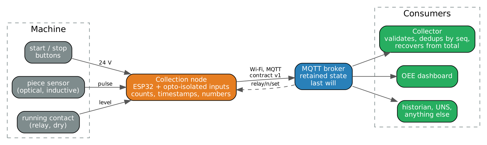
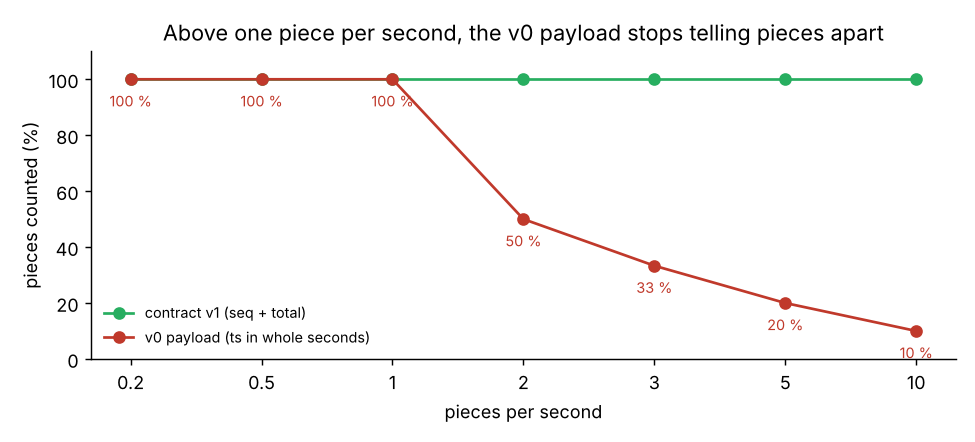
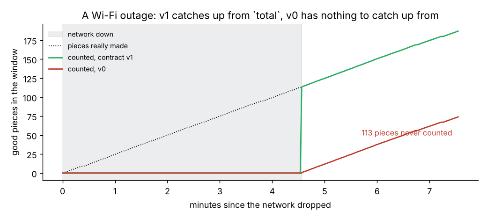
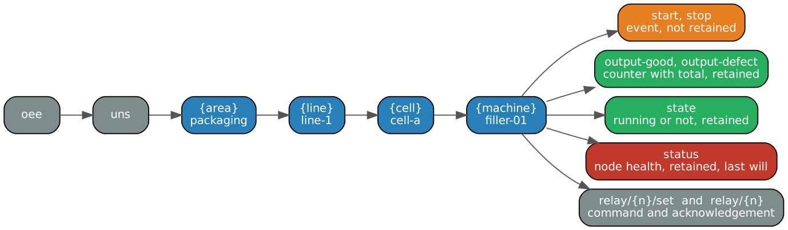
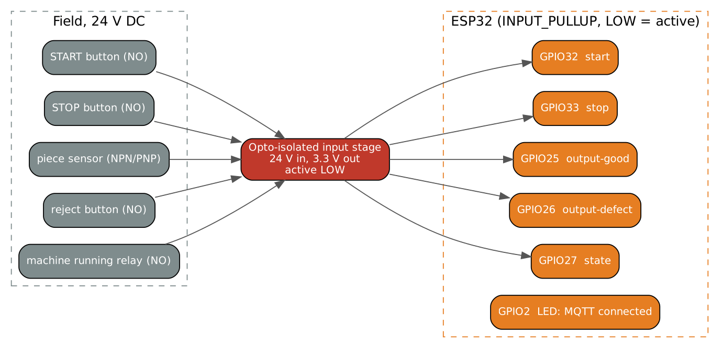
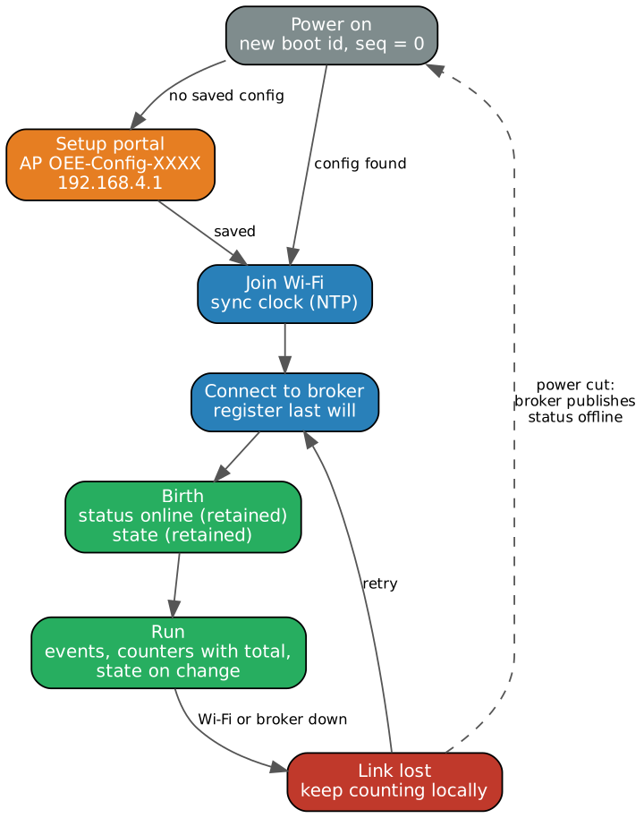
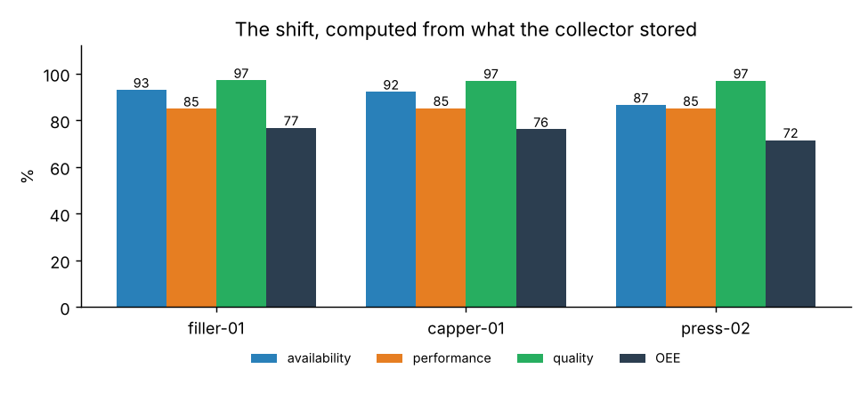
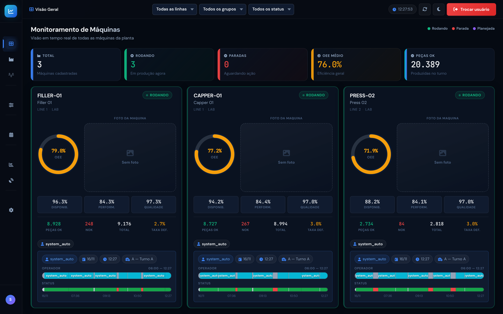
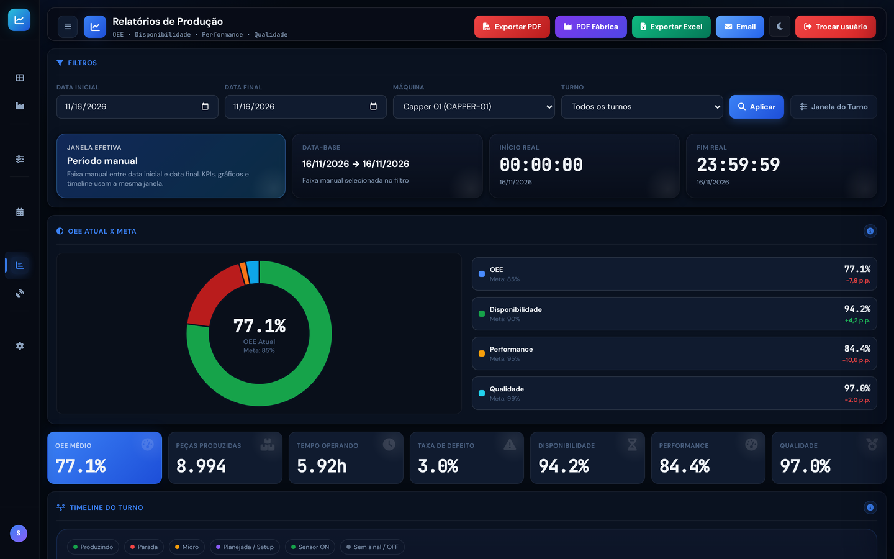
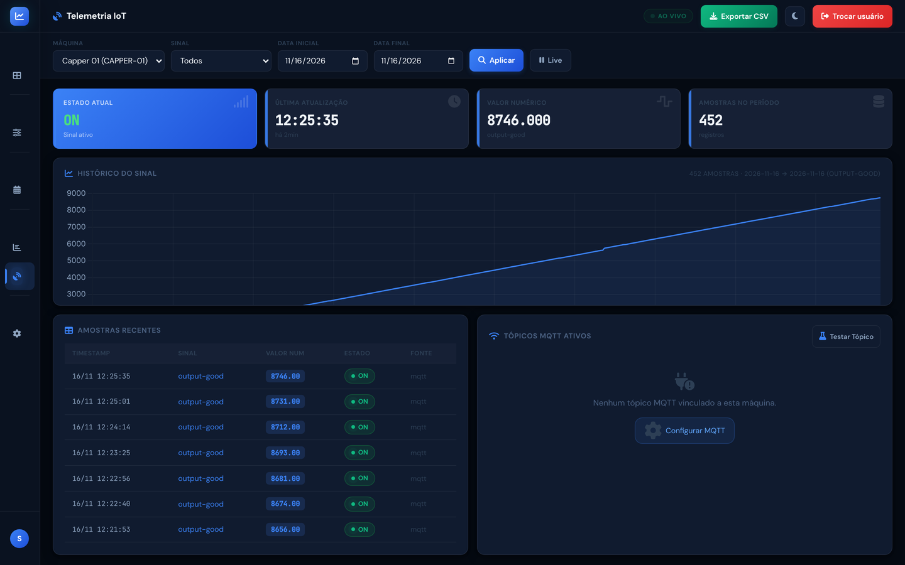

# OEE Monitor Lab · from an ESP32 on a machine to a trustworthy OEE

[](https://github.com/MatheusEduGarcia/oee-monitor-lab/actions/workflows/ci.yml)

A collection node (ESP32) reads start, stop, piece and running signals from a machine and publishes them over MQTT. This repository is about the part between the node and the OEE number: **the protocol**. It holds the firmware as it runs today, a written and tested contract that fixes what that firmware gets wrong, a reference collector, and a virtual node so all of it runs without hardware.



**Contents:** [The finding](#the-finding-that-started-it) · [Contract v1](#the-fix-contract-v1) · [Hardware](#the-hardware) · [Run it](#run-it) · [Dashboard](#the-system-it-feeds) · [Notebooks](#study-notebooks-portuguese-executed) · [Limits](#honest-limits)

| What | Where | Status |
|---|---|---|
| Protocol contract, JSON Schemas | `docs/`, `schemas/` | written and tested |
| ESP32 firmware (3 sketches) | `firmware/` | in use today (v0) |
| Virtual node, collector, adapter | `oeelab/` | 30 tests, CI |
| Study notebooks | `notebooks/` | executed, Portuguese |

## The finding that started it

Three situations from the shop floor, reproduced against a production OEE backend before a line of this repository was written:

| On the floor | Firmware payload today (v0) | Pieces counted |
|---|---|---|
| 3 pieces per second | `ts` in whole seconds, nothing else changes: pieces in the same second are identical bytes, and the receiver drops repeats | **10 of 30** |
| Node boots without NTP | `ts` is `1970-01-01T00:00:00` on every message | **3 of 8** |
| Wi-Fi down for 4.6 minutes in an 8 h shift | one message per pulse, nothing cumulative | **113 pieces never counted** |



## The fix: contract v1

Two fields and one rule about time. Full text in [docs/protocol.md](docs/protocol.md), schemas in [schemas/](schemas).

```json
{"v":1,"seq":42,"boot":"a1b2c3","ts":"2026-11-10T09:00:02.480Z","value":1,"total":1532}
```

| Field | Solves |
|---|---|
| `seq` | a real repeat has the same `seq`; a hole shows a lost message |
| `boot` | a reboot is not a counter going backwards |
| `total` | pieces from lost messages, and from the time offline, are recovered by difference |
| `ts` | UTC with milliseconds, **or absent**: never 1970, local time or `millis()` |

With v1 the same three situations count 30 of 30, 8 of 8 and every piece of the shift, and with 20 % of messages dropped on the way the collector reports 34 missing messages and still counts 200 of 200.



### Topic tree



## The hardware

One ESP32 per machine, up to five signals: start, stop, good piece, reject, running. Field signals at 24 V go through an opto-isolated stage, never straight to a 3.3 V pin. Details, a Modbus RTU variant for machines with no spare contact, and the setup portal in [docs/hardware.md](docs/hardware.md).

| Wiring | Node lifecycle |
|---|---|
|  |  |

## Run it

```bash
pip install -r requirements.txt
pytest                              # 30 tests; the broker test is skipped without one
mosquitto -p 1883 -d                # or any broker on localhost
python -m oeelab.demo               # 3 virtual nodes replay a shift, the collector checks it against the truth
python -m oeelab.check_node oee/uns/packaging/line-1/cell-a/filler-01   # bench check for a real board
```

```
machine              good      defect   A      P      Q      OEE
filler-01    11060/11060    326/326    93.0%  85.0%  97.1%  76.8%  ok
capper-01    10968/10968    350/350    92.2%  85.2%  96.9%  76.2%  ok
press-02      3435/3435     108/108    86.6%  85.2%  97.0%  71.6%  ok
```



## The system it feeds

The same shift, published in contract v1 into the OEE dashboard this collection hardware was built for (Flask, PostgreSQL, InfluxDB, MQTT; not part of this repository):



| Reports | Telemetry |
|---|---|
|  |  |

## Study notebooks (Portuguese, executed)

| # | Notebook | You learn |
|---|---|---|
| 01 | [O nó de coleta](notebooks/01_o_no_de_coleta.ipynb) | what the node reads, how it is wired, the three firmware dialects, last will |
| 02 | [O contrato v1](notebooks/02_contrato_v1.ipynb) | four experiments where v0 loses pieces, and the field that fixes each |
| 03 | [Do evento ao OEE](notebooks/03_do_evento_ao_oee.ipynb) | a full shift into OEE checked against the truth, and migrating with no reflash |

Each has a "stop and predict" before every experiment, common mistakes, a quiz and exercises.

## Layout

```
docs/protocol.md            the contract
docs/hardware.md            inputs, wiring, opto-isolation, node lifecycle, Modbus RTU variant
docs/firmware_v1_changes.md what changes in each sketch (specification, not yet flashed)
schemas/                    JSON Schema per message type
firmware/                   ESP32 sketches as they run today (v0)
oeelab/contract.py          topics, payloads, validation
oeelab/node.py              virtual node, v0 and v1 dialects
oeelab/collector.py         reference collector: dedup by seq, gaps, recovery from total, dead letters
oeelab/adapter.py           v0 to v1 at the edge, no reflashing
oeelab/oee.py               OEE from states and counters
```

## Honest limits

- The firmware changes for v1 are specified and implemented in the virtual node, **not yet compiled or flashed** on a board.
- `esp32_oee_webconfig` needs a `config.h` with its `ConfigManager` that is not published yet.
- Pieces counted between the last delivered message and a power cut are lost: `total` lives in RAM (see protocol, section 9).

## Related

- Protocols from the ground up: [iiot-protocols-examples](https://github.com/MatheusEduGarcia/iiot-protocols-examples) (MQTT, UNS, Sparkplug B, OEE)
- Hardware for an industrial node: [smart-manufacturing-edge](https://github.com/MatheusEduGarcia/smart-manufacturing-edge)
- Securing the broker: [ot-security-lab](https://github.com/MatheusEduGarcia/ot-security-lab)
- Giving the data meaning: [industrial-ontology-lab](https://github.com/MatheusEduGarcia/industrial-ontology-lab)

MIT license.
