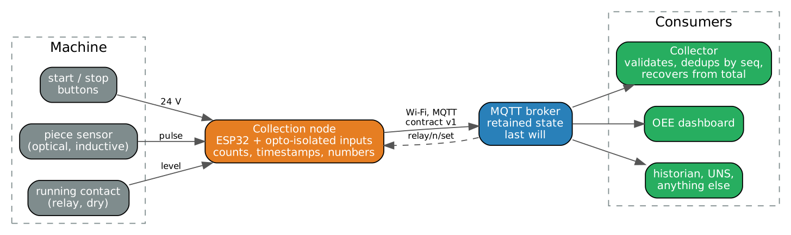
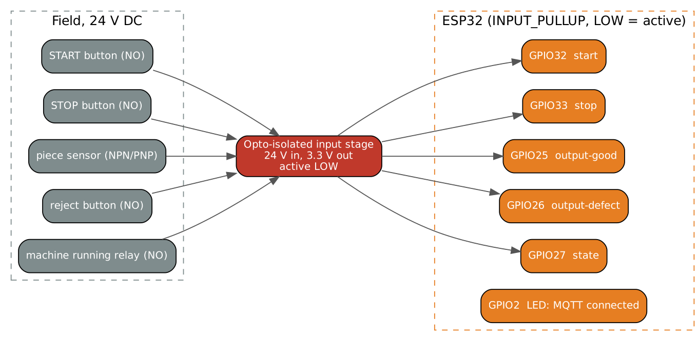
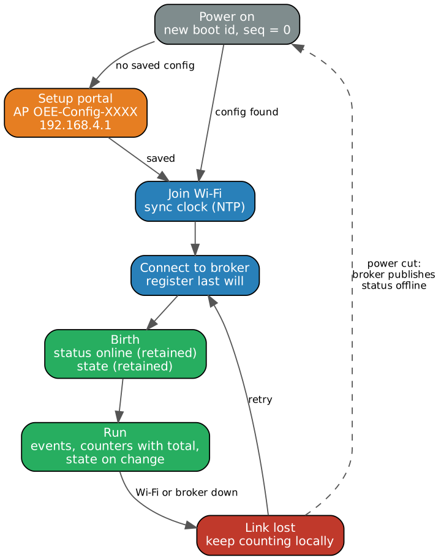

# The collection node

One ESP32 per machine. It reads up to five things from the machine and turns them into the messages of [contract v1](protocol.md).

## What the node reads

| Input | Typical source | Kind | Becomes |
|---|---|---|---|
| start | push button, or the machine's cycle-start signal | edge | `start` event, and `state` running |
| stop | push button, or the machine's stop signal | edge | `stop` event, and `state` stopped |
| good piece | optical or inductive sensor on the outfeed, or a PLC pulse output | pulse | `output-good` counter |
| rejected piece | operator button, or a reject-gate sensor | pulse | `output-defect` counter |
| running | a spare contact of the main contactor or of a "machine running" relay | level | `state` |

Not every machine has all five. A machine with only a running contact still gives availability; add a piece sensor and performance follows.

## Wiring

The sketches configure the inputs as `INPUT_PULLUP`, active LOW: a contact closing to GND is a logic 1 for the firmware. Default pins of `esp32_oee_full_signals`: GPIO32 start, GPIO33 stop, GPIO25 good piece, GPIO26 reject, GPIO27 running, GPIO2 the on-board LED that lights while MQTT is connected.

On a bench, a button between the GPIO and GND is enough. On a machine it is not:

- **Never connect 24 V field signals to an ESP32 pin.** The pins are 3.3 V and not 5 V tolerant. Put an opto-isolated input stage between the field and the board (a PC817-style module, or a board that already has isolated inputs). The drawing shows that stage.
- **Use dry contacts where you can.** A spare auxiliary contact gives a signal with no electrical connection to the machine's control circuit.
- **Keep the node's supply separate** from the machine's 24 V control supply, or isolate it. A shared ground through a long cable is how noise becomes counted pieces.
- **Debounce.** Mechanical contacts bounce for a few milliseconds. `esp32_oee_full_signals` requires a level to hold for `DEBOUNCE_MS` before it counts. `esp32_oee_webconfig` does not debounce yet, see [firmware_v1_changes.md](firmware_v1_changes.md).
- **Sensor speed.** A piece sensor must stay active longer than the debounce time. At 10 pieces per second with a 50 % duty cycle the pulse is 50 ms, right at the limit.

The reference design for a purpose-built board with isolated 24 V inputs, RS-485 and Ethernet is in [smart-manufacturing-edge](https://github.com/MatheusEduGarcia/smart-manufacturing-edge).

## Life of a node

`esp32_oee_webconfig` needs no recompiling to install. With no saved configuration it opens an access point named `OEE-Config-XXXX`; the installer connects a phone, opens `http://192.168.4.1` and walks through four steps: pins and a live view of the inputs, Wi-Fi, MQTT broker, and a publish test. The configuration is saved in the board's flash.

On every broker connection the node registers a last will on its `status` topic. If the board loses power or network, the broker publishes `online: false` for it, so "no data" and "node dead" stop looking the same on the dashboard.

## A legacy machine with no signals to spare

Some machines offer no free contact but do have a controller with a serial port. The same node can then act as a small gateway: an RS-485 transceiver (MAX485 or isolated equivalent) on a UART, reading Modbus RTU holding registers on a timer and publishing the same v1 messages.

| Register read from the controller | Becomes |
|---|---|
| run bit, or a status word | `state` |
| good-piece counter | `output-good`, with the controller's own counter as the source of `total` |
| reject counter | `output-defect` |

Reading a counter that already lives in the controller is better than counting pulses: the controller keeps counting while the node is offline or rebooting. The node only has to handle the counter wrapping around or being reset by the operator, which is a new `boot` in contract terms.

This variant is a design note here, not firmware. The Modbus side is worked through, with a simulated device, in lessons 02 and 08 of [iiot-protocols-examples](https://github.com/MatheusEduGarcia/iiot-protocols-examples).

## No hardware at hand

[`oeelab/node.py`](../oeelab/node.py) is the node without the board: same inputs, same messages, same last will. Everything in this repository, including CI, runs on it.
