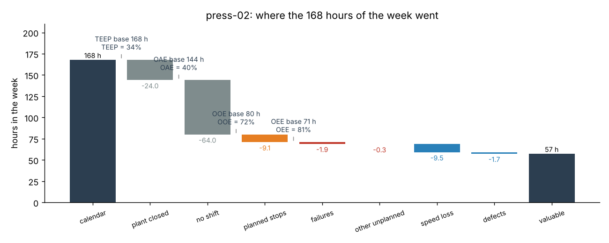

# Indicators beyond OEE

Every indicator here is computed by [`oeelab/kpi.py`](../oeelab/kpi.py) from what the collector stored, and checked in CI against the truth of the simulated week ([`oeelab/week.py`](../oeelab/week.py)). The study version is [notebook 04](../notebooks/04_alem_do_oee.ipynb).

## The time model

Every second of the period falls in exactly one bucket. The bucket comes from the `category` of the `state` message (contract v1, section 2.1 of [protocol.md](protocol.md)).

| Bucket | `category` | Examples |
|---|---|---|
| closed | `closed` | plant shut, holiday, no demand |
| unscheduled | `unscheduled` | no shift programmed |
| planned | `planned` | meal break, changeover, preventive maintenance |
| failure | `failure` | the machine broke: jam, seal wear, hydraulic leak |
| other unplanned | `unplanned` | no material, no operator |
| run | (running) | producing |



## The OEE family

Performance and quality are the same in all of them. Only the reference time changes:

```
indicator = good pieces × ideal cycle time / reference time
```

| Indicator | Reference time | Answers |
|---|---|---|
| **TEEP** Total Effective Equipment Performance | calendar time | how much of the asset's total capacity becomes good product |
| **OAE** Overall Asset Effectiveness | calendar − closed | the same, excluding time the plant could not have produced at all |
| **OOE** Overall Operations Effectiveness | calendar − closed − unscheduled | how well the time we staffed was used, planned stops counted as loss |
| **OEE** Overall Equipment Effectiveness | OOE time − planned stops | how well the time we planned to produce was used |

So TEEP ≤ OAE ≤ OOE ≤ OEE, always. The gap between two neighbours is exactly one bucket, which is what makes the comparison useful: OEE to OOE is the cost of planned stops, OOE to OAE is the cost of not running shifts, OAE to TEEP is the cost of closing the plant.

### Definitions are not uniform

TEEP, OOE and OEE are used consistently across the TPM literature and ISO 22400-2. **OAE, OPE and OFE are not**: vendors, consultancies and papers define them in different ways (OAE is sometimes a synonym of OOE, or of TEEP; OPE and OFE vary in how machines are aggregated). The definitions above and below are the ones used in this repository. Compare a number from here with another source only after checking that the formula is the same.

## Line and plant

| Indicator | Definition used here |
|---|---|
| **OPE** Overall Process Effectiveness, per line | good pieces leaving the line × ideal cycle of the bottleneck machine / planned production time of the line |
| **OFE** Overall Factory Effectiveness | Σ valuable time of all lines / Σ planned production time of all lines (lines weighted by planned time) |

OPE looks at what the line delivers, not at each machine: a filler at 95 % is worth nothing if the capper after it stops. In this simulation the machines of a line run independently, so OPE only shows the effect of measuring at the line exit. A coupled line, where a stop upstream starves the next machine, is not modelled yet.

## Reliability

Only stops with `category = failure` count. Meals, changeovers and missing material are not failures.

| Indicator | Formula |
|---|---|
| **MTBF** mean time between failures | run time / number of failures |
| **MTTR** mean time to repair | time in failure / number of failures |
| intrinsic availability | MTBF / (MTBF + MTTR) |

MTTR here is the time the machine stood still, from the stop to running again. It includes waiting for the technician and for parts, which a maintenance department may report separately. Per failure mode, the same numbers point at what to fix first.

Without the `category`, the only figures available are mean time between **stops** and mean stop duration. Notebook 04 shows how far they are from MTBF and MTTR on the same week.

## References

- ISO 22400-2:2014, *Automation systems and integration: Key performance indicators for manufacturing operations management, Part 2*.
- S. Nakajima, *Introduction to TPM: Total Productive Maintenance*, Productivity Press, 1988.
