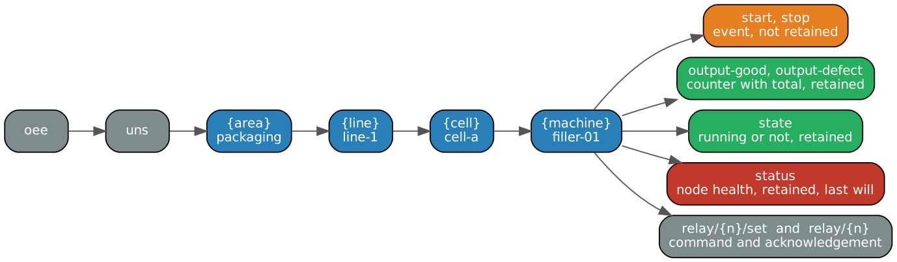

# Collection node protocol, contract v1

This is the agreement between a collection node (an ESP32 wired to a machine) and anything that consumes its data. It says which topics exist, what each payload carries, what is retained, and what each side may assume when messages are late, repeated or lost.

The same contract exists as code in [`oeelab/contract.py`](../oeelab/contract.py) and as JSON Schema in [`schemas/`](../schemas). If this text and the schemas disagree, the schemas win and this text has a bug.

## 1. Why a contract

The firmware in [`firmware/`](../firmware) grew one sketch at a time, and each sketch speaks a slightly different dialect (section 8). They all work on the bench. Three things go wrong on a real line, and all three were reproduced against a production backend before this contract was written:

| What happens on the floor | What the v0 payload does | Result |
|---|---|---|
| Machine makes more than one piece per second | `ts` has whole seconds and nothing else changes, so two pieces in the same second are the same bytes. A receiver that drops repeated messages drops real pieces. | 30 pieces at 3 per second counted as 11 |
| Node boots without reaching the NTP server | `ts` reads `1970-01-01T00:00:00` on every message | 8 pieces counted as 3 |
| Wi-Fi drops for a few minutes | A pulse that is not sent is gone, there is nothing cumulative | every piece made during the outage is lost |

The contract fixes the three with two small fields, `seq` and `total`, and one rule about time.

## 2. Topics

```
{prefix}/uns/{area}/{line}/{cell}/{machine}/{signal}
oee/uns/packaging/line-1/cell-a/filler-01/output-good
```



- Every segment is lower case ASCII, digits and single hyphens: `^[a-z0-9]+(-[a-z0-9]+)*$`. Names are turned into segments by `contract.slug()`.
- `{prefix}` is free (`oee` by default) and may have several levels. It is the only part that changes between sites sharing a broker.
- One node serves one machine. The machine path is the identity of the node.

| Signal | Schema | Retained | Direction | Meaning |
|---|---|---|---|---|
| `start` | [event](../schemas/event.schema.json) | no | node to broker | Start was requested (button or signal edge) |
| `stop` | [event](../schemas/event.schema.json) | no | node to broker | Stop was requested |
| `output-good` | [counter](../schemas/counter.schema.json) | yes | node to broker | Good pieces counted |
| `output-defect` | [counter](../schemas/counter.schema.json) | yes | node to broker | Rejected pieces counted |
| `state` | [state](../schemas/state.schema.json) | yes | node to broker | Machine running or not, on change |
| `status` | [status](../schemas/status.schema.json) | yes | node to broker, and last will | Health of the node itself |
| `relay/{n}/set` | [command](../schemas/command.schema.json) | no | broker to node | Switch output n (1 to 8) |
| `relay/{n}` | [command](../schemas/command.schema.json) | yes | node to broker | Output n really changed, echoing the command `id` |

## 3. Payloads

Every message from the node is a JSON object with the same envelope:

| Field | Type | Required | Rule |
|---|---|---|---|
| `v` | integer | yes | Always `1`. A receiver refuses what it does not know. |
| `seq` | integer | yes | Starts at 0 on boot, +1 on every message the node publishes (all signals share it), wraps at 2^32. |
| `boot` | string | yes | Random hex id drawn at power-up. A new value means `seq` and every `total` restarted. |
| `ts` | string | no | UTC, RFC 3339, milliseconds, ending in `Z`. **Omitted while the clock is not synchronised.** |

Examples:

```json
// start
{"v":1,"seq":41,"boot":"a1b2c3","ts":"2026-11-10T09:00:00.120Z","value":1}

// output-good: one piece, 1 532 since boot
{"v":1,"seq":42,"boot":"a1b2c3","ts":"2026-11-10T09:00:02.480Z","value":1,"total":1532}

// state
{"v":1,"seq":43,"boot":"a1b2c3","ts":"2026-11-10T09:14:07.003Z","value":0,"running":false}

// status, published by the node on connect (birth)
{"v":1,"online":true,"boot":"a1b2c3","fw":"oee-node 1.0.0","ip":"192.168.0.50","rssi":-61,"uptime_s":0,"clock_synced":true}

// status, published by the broker when the node disappears (last will)
{"v":1,"online":false}
```

Rules that the schemas enforce:

- A counter message always carries `value` (pieces in this message, at least 1) and `total` (pieces since boot, including this message). `total` is never smaller than `value`.
- `ts` is either a correct UTC instant or absent. Local time without offset, milliseconds since boot and the 1970 epoch are refused. A receiver stamps a message without `ts` with its own time of receipt.
- Unknown extra fields are allowed and ignored, so a node may add diagnostics without breaking anyone.
- The last will cannot carry `seq`, `boot` or `ts`: the broker stores it at connect time and publishes it later, on the node's behalf.

## 4. Delivery: what is guaranteed and what is not

The usual Arduino MQTT client publishes with QoS 0 only. The contract does not pretend otherwise. It assumes that any single message can be lost, and makes the loss harmless where it matters:

| Signal | If a message is lost | If a message arrives twice |
|---|---|---|
| counters | The next message brings `total`. The receiver adds the difference, so no piece is lost. A hole in `seq` records that it happened. | Same `boot` and `seq` as one already processed: dropped. |
| `state` | Retained, and republished on every reconnect. The receiver converges to the truth. | Dropped by `seq`. |
| `start`, `stop` | Lost. They record intent, not truth. Run time is computed from `state`. | Dropped by `seq`. |
| `status` | Retained. The last will covers a node that dies silently. | Harmless, it is a level. |

The one piece count that can still be lost: pieces counted between the last message that arrived and a power cut, because `total` lives in RAM. v1 accepts that limit (section 9).

## 5. What the receiver must do

[`oeelab/collector.py`](../oeelab/collector.py) is the reference. In order:

1. Refuse topics outside section 2 and payloads that fail the schema. Keep them, with the reason, in a dead-letter table.
2. `status`: record online or offline. A birth with a new `boot` resets `seq` and totals for that node.
3. Same `boot` and `seq` not greater than the last one seen: duplicate, drop.
4. `seq` jumped: record a gap of `seq - last - 1` messages.
5. Counter: add `total - last_total`. If that is more than `value`, the surplus was recovered from lost messages.
6. Store with `ts`, or with the time of receipt when `ts` is absent.
7. A message delivered from the broker's retained store (the retain flag is set on delivery) is old news, not an event: skip the `seq` checks. A retained counter from a boot the receiver has never seen sets the baseline and counts nothing; from the boot it already knows, the difference in `total` is recovered.

## 6. Commands

A command is sent to `relay/{n}/set` with an `id` chosen by the sender. The node switches the output and publishes the new level on `relay/{n}`, retained, echoing `id`. The sender treats the command as done only when it sees its own `id` come back. A command that is not acknowledged within the sender's timeout is reported as failed, never assumed.

Commands are not retained: a node that reconnects hours later must not act on a stale order.

## 7. Versioning

- `v` changes only when a receiver written for the old version would misread the new one. Adding an optional field does not change `v`.
- A receiver supports the versions it lists and sends everything else to the dead-letter table.
- The topic layout is part of the contract. A new layout is a new `v`.

## 8. Migrating from v0

Three dialects are in use by the sketches in [`firmware/`](../firmware):

| Sketch | Topic | Payload | Problems |
|---|---|---|---|
| `esp32_oee_full_signals` | `oee/uns/.../output`, `.../defect`, `.../start`, `.../stop`, `.../state` | `{"ts":"2026-11-10T06:00:00","value":1,"machine_id":"FILLER-01"}` | `ts` in whole seconds and local time with no offset; 1970 without NTP; one message per pulse, nothing cumulative |
| `esp32_oee_webconfig` | `{base}/input/{n}`, commands on `{base}/relay/+` | `{"label":"Start","state":1,"ts":123456}` | `ts` is milliseconds since boot; the signal name is only a free-text label; inputs are published on every level change with no debounce, although the setup page states 50 ms |
| `esp32_cnc_lathe_1button` | `lab/line1/cnc_lathe/button/start`, `.../status` | `{"ts":"...","value":1.0,"machine_id":"CNC-001"}` and `{"ts":"...","running":true,...}` | topic outside the namespace; same `ts` problems as the first sketch; `status` means machine running here and node online elsewhere |

Two ways forward, which can be combined:

1. **Adapter at the edge, no reflashing.** [`oeelab/adapter.py`](../oeelab/adapter.py) subscribes to the old topics and republishes each message as v1, adding `seq`, a receipt timestamp and a running `total`. It removes the duplicate and clock problems for everything downstream. It cannot recover a pulse that never reached the broker.
2. **Firmware change.** [`firmware_v1_changes.md`](firmware_v1_changes.md) lists the changes, about thirty lines per sketch. This is the only way to survive a network outage without losing pieces.

Signal names map as follows:

| v0 | v1 |
|---|---|
| `output`, `output_good` | `output-good` |
| `defect`, `output_defect` | `output-defect` |
| `input/{n}` with a label | the signal that input is wired to |
| `status` meaning machine running | `state` |
| `status` meaning node online | `status` |

## 9. Open points

- **Totals across a power cut.** Keeping `total` in non-volatile memory would close the last gap, but then `total` outlives `boot` while `seq` does not. That needs a separate counter epoch in the payload and is left for a v2.
- **Analog signals** (speed, temperature, current) are not in v1. They need a sampling and deadband policy of their own.
- **Security.** The contract says nothing about transport. Broker authentication, per-node ACLs and TLS are deployment decisions, worked through in [ot-security-lab](https://github.com/MatheusEduGarcia/ot-security-lab).
- **Sparkplug B** solves the same birth, death and sequence problems with a binary payload and a fixed namespace. v1 keeps JSON because the nodes and the people debugging them read it directly. The comparison is lesson 07 of [iiot-protocols-examples](https://github.com/MatheusEduGarcia/iiot-protocols-examples).
